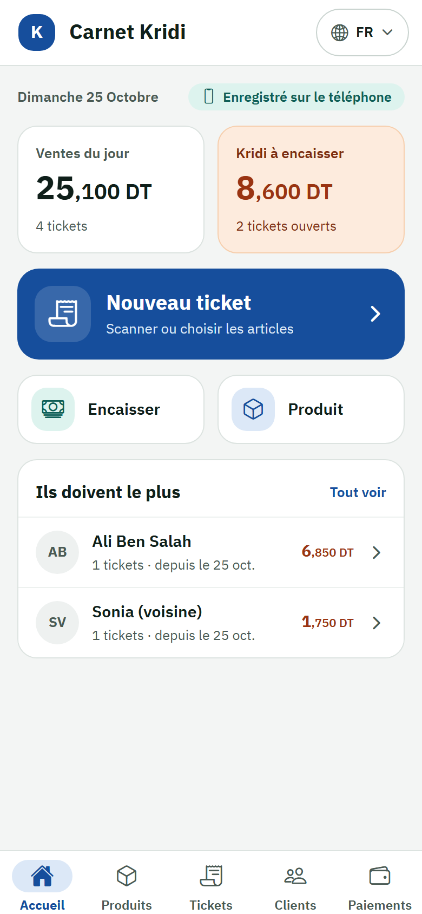
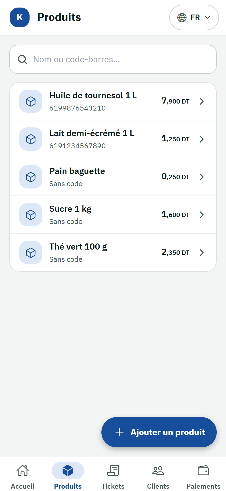
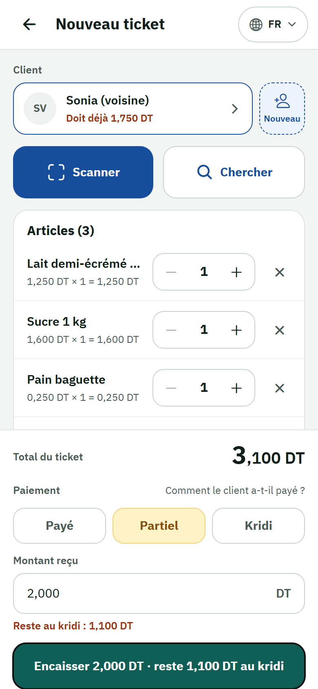
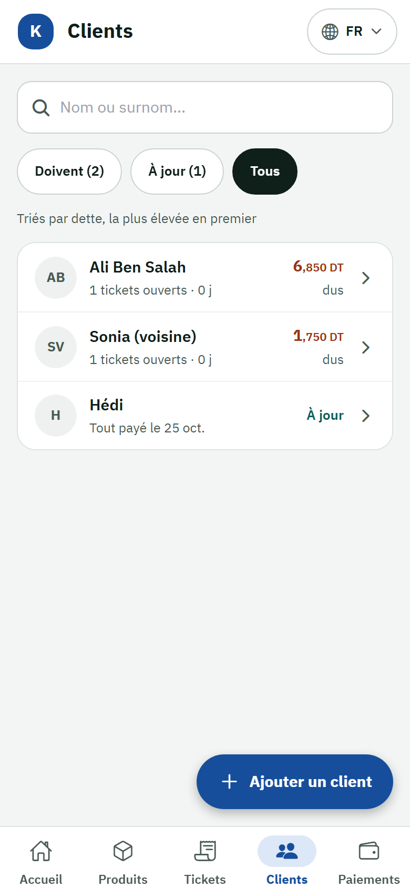
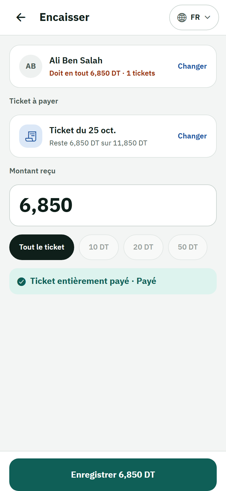
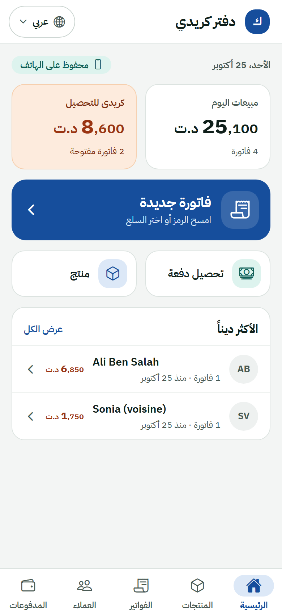

# Shop Keeper — Application mobile

Application du commerçant : un **registre de crédit (kridi)** qui fonctionne **hors ligne**, en **arabe (RTL)** et en **français (LTR)**. Elle permet de gérer les produits, les clients, les tickets et les paiements, et affiche les totaux du jour.

← Retour au [README principal](../README.md)

---

## Aperçu

<!-- Captures prises en 390×844 (iPhone 14). Remplacer les fichiers dans docs/screenshots/ en gardant les mêmes noms. -->

| Tableau de bord | Produits | Nouveau ticket |
|:---:|:---:|:---:|
|  |  |  |
| **Clients** | **Paiement** | **Arabe (RTL)** |
|  |  |  |

> Pour ajouter ou mettre à jour ces captures, voir [Captures d'écran](#captures-décran) plus bas.

---

## Fonctionnalités

**Registre kridi** ([spec 001](../specs/001-kridi-credit-ledger/spec.md))
- Catalogue produits : nom, code-barres facultatif, prix de vente.
- Clients identifiés par un surnom choisi par le commerçant. Le vrai nom et le téléphone sont facultatifs.
- Tickets créés en scannant ou en choisissant les produits, avec quantités et total avant enregistrement.
- Paiements rattachés à un ticket. Par défaut, c'est le plus ancien ticket impayé qui est proposé.
- Soldes par client, plus gros débiteurs et historique.
- Corrections et annulations qui laissent une trace (`ledger_audit_events`).

**Ergonomie et tableau de bord** ([spec 002](../specs/002-ledger-usability-dashboard/spec.md))
- Barre d'onglets en bas (Accueil, Produits, Tickets, Clients, Paiements) et barre du haut (retour, titre, langue).
- Tableau de bord : ventes du jour, total restant dû, et actions rapides.
- Scan de code-barres ou de QR code à la caméra, avec saisie manuelle possible si besoin.
- Création d'un client ou d'un produit directement depuis un ticket, sans perdre ce qui a déjà été saisi.
- Confirmation demandée avant de quitter un formulaire non enregistré.

---

## Stack

| Domaine | Choix |
|---|---|
| Framework | Expo SDK 57, React Native 0.86, React 19 |
| Langage | TypeScript (strict) |
| Navigation | Expo Router (routes basées sur les fichiers dans `src/app/`, routes typées) |
| État | Redux Toolkit + React Redux |
| Stockage | `expo-sqlite`, base locale `shop_keeper_ledger.db` |
| Styles | NativeWind 4 (Tailwind 3) |
| Caméra / scan | `expo-camera` |
| Icônes | `@expo/vector-icons` (Ionicons) |
| Tests | Vitest |
| Qualité | ESLint (`eslint-config-expo`), `tsc --noEmit` |

---

## Démarrer

**Prérequis :** Node 20 ou plus récent, npm, et au choix un téléphone avec Expo Go, un émulateur Android ou un simulateur iOS.

```bash
npm install
npm start               # serveur de dev Expo
npm run android         # ou : npm run ios / npm run web
```

> Pour ajouter une dépendance, utilise toujours `npx expo install <paquet>` : il choisit la version compatible avec le SDK.
> **Mode lent (développement).** `EXPO_PUBLIC_LEDGER_DELAY_MS=3000 npx expo start -c` ralentit chaque accès à la base de 3 s, pour voir les squelettes, le loader et le message « Ça prend plus de temps que prévu ». Sans effet dans un build de production.
> **Outils de développement.** Dans un build de dev, un appui long sur le titre de la barre du haut lance une tâche de test en arrière-plan (toast « en cours »), et un appui long sur le logo ajoute 300 clients et 2 000 tickets de test.
> La caméra demande un vrai appareil. Si tu ajoutes un module natif qui n'est pas inclus dans Expo Go, il faudra un *development build* (`npx expo run:android`).

### Scripts

| Commande | Effet |
|---|---|
| `npm start` | Lance le serveur Expo |
| `npm run android` / `ios` / `web` | Ouvre directement sur la plateforme choisie |
| `npm run lint` | ESLint |
| `npm run typecheck` | Vérification TypeScript |
| `npm test` | Tests Vitest (`src/**/*.test.ts`) |
| `npm run validate` | Lint, typecheck et tests : à lancer avant chaque commit |

---

## Architecture

```
src/
├── app/                    # Écrans (Expo Router) — un fichier = une route
│   ├── _layout.tsx         # Shell : Redux, ouverture de la DB, TopBar, Stack, BottomTabs
│   ├── index.tsx           # Accueil → tableau de bord
│   └── ledger/             # products, tickets, customers, payments, *-form, balances, history…
├── features/
│   ├── feedback/           # useAsyncAction, useLedgerQuery, toasts, loader (slice Redux `feedback`)
│   └── ledger/
│       ├── screens/        # Écrans métier (montés par src/app/ledger/*)
│       ├── components/     # Formulaires, sélecteurs, scanner, dialogues, états de feedback
│       ├── services/       # Logique métier + repositories SQLite (+ tests)
│       ├── store/          # ledgerSlice (Redux)
│       ├── types/          # Customer, Product, Ticket, Payment, PendingChange
│       └── styles/         # ledger.css (classes NativeWind)
├── navigation/             # TopBar, BottomTabs, LanguageMenu, registre des features
├── db/                     # Schéma SQLite, migrations, ouverture, file d'attente (runQueued)
├── i18n/                   # Traductions fr / ar / en, direction RTL/LTR, langue sauvegardée
├── lib/                    # money.ts (millimes), id.ts (UUID)
├── store/                  # Store Redux global
└── constants/, hooks/, utils/
```

### Flux de données

```
Écran ─► useAsyncAction / useLedgerQuery ─► service (règles métier) ─► repository ─► runQueued ─► SQLite (async)
                                    │
                                    └─► pending_changes   (journal pour la future synchro)
                                    └─► ledger_audit_events (historique des corrections)
```

### Tables SQLite

`products`, `customers`, `tickets`, `ticket_lines`, `payments`, `pending_changes`, `ledger_audit_events` et `app_settings`. Le schéma est dans [`src/db/schema.ts`](src/db/schema.ts).

### Ajouter une feature à la navigation

Les features sont déclarées à un seul endroit, dans [`src/navigation/features.ts`](src/navigation/features.ts). Chacune y déclare ses onglets (`items`) et ses écrans de formulaire (`formFragments`), sur lesquels la barre d'onglets est masquée. Le sélecteur de feature apparaît dans la barre du haut dès que **deux features ou plus** sont enregistrées.

---

## Règles du projet

Ces règles résument la [constitution](../.specify/memory/constitution.md).

- **Argent.** Toujours des entiers en millimes (`src/lib/money.ts`), jamais de `float`.
- **Textes.** Aucun texte en dur : tout passe par `src/i18n/translations/{fr,ar,en}.json`, et les trois fichiers doivent rester synchronisés.
- **Direction.** Utiliser des classes adaptées au sens de lecture (`start` / `end`) plutôt que `left` / `right`.
- **Styles.** Classes NativeWind ou fichiers `.css` dédiés. Pas de `StyleSheet` ni de style inline dans les TSX.
- **Accessibilité.** `accessibilityLabel` et `accessibilityRole` sur chaque contrôle, zones tactiles d'au moins 48 px.
- **États.** Chaque écriture passe par `useAsyncAction` (bouton occupé, loader après 300 ms, toast de résultat, « Réessayer ») et chaque lecture par `useLedgerQuery` (squelettes, « Mise à jour… », erreur avec « Réessayer »). Un écran ne gère jamais son propre chargement.
- **Hors ligne.** Aucun appel réseau dans les features 001 et 002 : les données restent sur l'appareil.

---

## Captures d'écran

### Où les ranger

```
shop-keeper-mobile/docs/screenshots/
├── fr/   01-dashboard.png  02-products.png  03-ticket-form.png  04-customers.png  05-payment-form.png
└── ar/   01-dashboard.png  …
```

- Un dossier par langue, et des noms préfixés par un numéro pour garder l'ordre.
- Même taille pour toutes les captures (portrait, environ 390×844 ou 1080×2340), en PNG.
- Dans le README, on les affiche avec `` dans un tableau. Le Markdown pur `` ne permet pas de fixer la largeur sur GitHub.
- Prends les captures avec des **données de démo**, jamais avec de vrais clients.

### Comment les prendre

**Android (émulateur ou téléphone branché en USB)**

```bash
adb exec-out screencap -p > docs/screenshots/fr/01-dashboard.png
```

**Simulateur iOS (macOS)**

```bash
xcrun simctl io booted screenshot docs/screenshots/fr/01-dashboard.png
```

**Navigateur (le plus rapide)**

1. Lance `npm run web`.
2. Ouvre les DevTools (F12), active le mode appareil (Ctrl+Shift+M) et choisis « iPhone 14 Pro ».
3. Dans le menu ⋮ de la barre d'appareil, clique sur « Capture screenshot ».

**GIF de démo (facultatif)**

Enregistre une courte vidéo avec `adb shell screenrecord /sdcard/demo.mp4` ou l'enregistreur d'écran du téléphone, puis convertis-la en GIF de moins de 5 Mo. Tu peux ensuite l'ajouter en haut du README.
